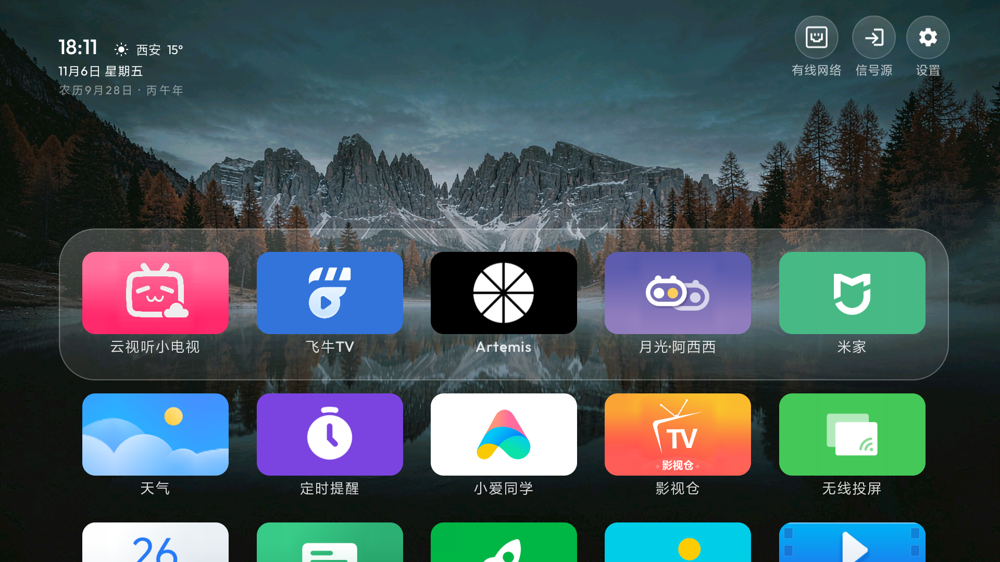

# 简洁电视桌面 · Clean TV Home

给国产 Android TV（小米 / MTK 机型为主）用的第三方桌面：没有广告、没有推荐位，开机自动接管 Home 键，磁贴式应用列表 + 天气 + 可换壁纸 + 屏保，壁纸可以直接用手机扫码传进去。



**这不是从零写的项目。** 它基于开源项目 [Gathin23/cleanyourtv](https://github.com/Gathin23/cleanyourtv)（MIT）的 launcher，在上游基础上做了较大幅度的本地化改造和功能补充，并且与上游 `main` 已经分叉。来源与改动都在下面写清楚。

---

## 一、基于什么

| 项 | 说明 |
|---|---|
| 上游项目 | [Gathin23/cleanyourtv](https://github.com/Gathin23/cleanyourtv) |
| 上游许可 | MIT，Copyright (c) 2026 Gathin（原文保留在 `LICENSE`） |
| 取用什么 | 只取了 `launcher/`（Android 应用）与主题思路；未包含上游的 `addons/`、`docs/`、`tests/`、`tools/` |
| 起点版本 | 上游 2026 年 11 月初的快照，应用内 `versionName` 为 `3.3`、`versionCode` 为 `12` |
| 参考实现 | [pengchujin/aerial-tv](https://github.com/pengchujin/aerial-tv)（MIT），参考其 Home 键守护与设置页交互，未复制代码 |

上游在那之后仍在持续演进（例如把屏保重构进 `ClockScene`、补齐了单元测试），**本仓库没有跟进这些重构**。因此本仓库更适合当作"一份可读的定制版快照"，而不是上游的镜像。想跟上游最新代码，建议只把下面第 3 节的两处改动挑过去。

## 二、改了什么

### 1. 界面与交互

| 改动 | 主要文件 |
|---|---|
| 磁贴封面缓存、边缘滚动、磁贴尺寸与圆角体系 | `TileArtCache`、`EdgeScrollView`、`AppAdapter` |
| 顶栏胶囊（有线网络 / 信号源 / 设置）与信号源切换面板 | `QuickSettingsActivity`、`item_source`、`popup_inputs` |
| 中文界面的换行、字号、控件尺寸修正 | `values-zh-rCN/`、`layout/`、`styles.xml` |
| 桌面设置页：列数、程序坞行数、透明度、时钟格式、农历、壁纸、屏保、动态效果 | `LauncherSettingsActivity`、`activity_launcher_settings.xml` |

### 2. 壁纸、屏保与天气

| 改动 | 说明 |
|---|---|
| 主题内置与自愈 | `assets/defaults/` 打包整套主题（配置、磁贴顺序、壁纸）；主题目录被清理器删空或读坏时，桌面启动会按内置资源重建 |
| 壁纸轮换与缓存 | `WallpaperRotation`、`WallpaperCache`：顺序/随机播放、按时段分组、文件名即标题、解码缓存 |
| 屏保样式 | `ScreensaverStyle`、`ScreensaverScene`：时钟·光晕、时钟·壁纸、时钟·纯黑、大日期、每日一句、全屏壁纸 |
| 天气 | `Weather`：桌面左上角显示城市与温度，失败自动重试 |

### 3. 2026-11-15 的修复与新增

| 类型 | 内容 |
|---|---|
| 修复 · 冷启动首帧 | 开机后第一次按方向键会卡约 0.28 秒。原因是首次焦点动画要在同一帧给"失去焦点"和"获得焦点"两个磁贴各建一个硬件图层，而这台电视**不允许侧载应用写 shader 缓存**（`libEGL: code_cache … Permission denied`），GPU 只能现场编译，实测 97 ms 全卡在渲染线程。修法：首次布局完成后，在启动动画期间主动给两个磁贴各建一次图层（不带动画、按磁贴当前缩放），把编译提前到用户按键之前。实测首次按键 **101/91/85 ms → 12/9/8 ms**（`MainActivity.warmFocusLayer()`） |
| 新增 · 手机加壁纸 | 应用内置一个极小的 HTTP 服务（8080 起，占用则往上找）。手机或电脑连同一 WiFi 打开 `http://电视IP:8080` 即可上传：图片按 EXIF 转正、长边缩到 1920、转 JPEG，写入主题的 `wallpapers/` 目录，自动出现在「壁纸样式」里。单张上限 24 MB、最多 60 张，只能删自己传的，主题自带图受保护（`UploadServer.java`） |
| 新增 · 扫码入口 | 设置页「手机添加壁纸」显示二维码（ZXing 生成），手机相机或微信扫一下就打开上传页，不必手输网址 |

## 三、编译与安装

需要 JDK 17 与 Android SDK（`compileSdk 34`）。

```bash
cd launcher
# 首次编译前先写 local.properties：sdk.dir=/path/to/Android/sdk
./gradlew assembleRelease
# 产物：app/build/outputs/apk/release/app-release.apk
```

国内网络可用仓库内的阿里云镜像脚本：

```bash
./gradlew assembleRelease --init-script init-aliyun.gradle
```

装到电视：

```bash
adb connect <电视IP>:5555
adb install -r app/build/outputs/apk/release/app-release.apk
# 设为默认桌面
adb shell cmd package set-home-activity --user 0 com.gathin.tvhome/.MainActivity
```

装好后建议在系统设置里允许它自启动 / 后台运行，否则部分机型回桌面时会重新启动一次。

## 四、目录

```
launcher/            Android 应用（Gradle 工程）
  app/src/main/java/com/gathin/tvhome/   桌面源码
  app/src/main/assets/defaults/          内置主题（配置 / 顺序 / 壁纸）
  init-aliyun.gradle                     国内镜像构建脚本
themes/aerial/       随包主题：config.json + 壁纸 + 5 张轮换图
docs/screenshot.png  截图
NOTICE.md            上游与第三方组件署名
```

## 五、已知限制

- `applicationId` 仍是 `com.gathin.tvhome`，与上游相同。想和上游版本共存需要自己改包名。
- 主题目录固定在 `/sdcard/Android/media/com.gathin.tvhome`；该目录被系统清理后会自动重建，但自定义的壁纸会丢。
- 上传页是**局域网免密**的：同网段任何人都能传图、删掉别人传的图。只建议在家里的 WiFi 用。
- 只在小米电视（MTK MT5895，Android 9，1920×1080）上验证过，其他机型未测。
- 与上游已分叉，合并上游新版本需要手工挑改动。

## 六、许可

MIT，见 [LICENSE](LICENSE)。上游版权归 Gathin，本仓库的修改以同样条款发布。第三方组件（字体、图标、ZXing）的许可见 [NOTICE.md](NOTICE.md)。

---

## English

A third-party home screen for China-market Android TVs: no ads, no recommendation rows, takes over the HOME key at boot, tile-based app grid with weather, wallpapers and a screensaver — and wallpapers can be pushed from a phone by scanning a QR code.

It is **derived from [Gathin23/cleanyourtv](https://github.com/Gathin23/cleanyourtv) (MIT)** — only the `launcher` part, at the upstream snapshot of early November 2026 (`versionName` 3.3). This fork has diverged: it adds a bundled self-healing theme, wallpaper rotation and caching, six screensaver styles, a weather widget, plus two fixes made in November 2026 — a first-frame warm-up that removes the ~0.28 s stall on the first remote key press after a cold boot, and an in-app HTTP server (with a QR code entry) for adding wallpapers from a phone or computer on the same WiFi.

Build with `cd launcher && ./gradlew assembleRelease` (JDK 17, compileSdk 34). Licensed under MIT; see [NOTICE.md](NOTICE.md) for upstream and third-party attribution.
